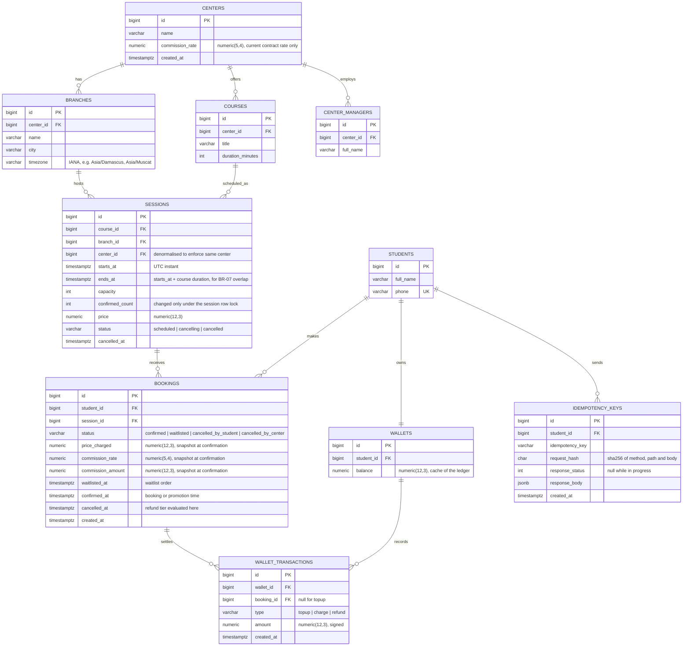

## A. Conflicts
| ID | BR | ERD element | Problem | My fix |
| --- | --- | --- | --- | --- |
| C1 | BR-01, BR-02 | SESSIONS.branch_id | A session can join a course of center A to a branch of center B, because each FK is checked alone. | Add SESSIONS.center_id with composite FKs (course_id, center_id) to COURSES and (branch_id, center_id) to BRANCHES. |
| C2 | BR-03 | COURSES.price | Price is set per session and may differ by branch, but the ERD allows one price per course. | Move price to SESSIONS.price numeric(12,3) and drop COURSES.price. |
| C3 | BR-04 | SESSIONS.capacity | Capacity is a bare number, so nothing in the schema stops concurrent requests from confirming more seats than it allows. | Add SESSIONS.confirmed_count with CHECK (confirmed_count BETWEEN 0 AND capacity), changed only under the session row lock in the same transaction as the booking. |
| C4 | BR-05 | WALLET_TRANSACTIONS.updated_at | The ledger must never be edited, yet the table is modelled as mutable. | Drop updated_at and block UPDATE and DELETE on the table with a database trigger. |
| C5 | BR-05 | WALLET_TRANSACTIONS.amount | A bare float amount cannot hold money exactly and cannot tell a top-up, a deduction and a refund apart or link them to a booking. | Add type (topup, charge, refund), booking_id and a signed numeric(12,3) amount, with a CHECK tying the sign and booking_id to the type. |
| C6 | BR-05 | WALLETS.balance | Float cannot hold money exactly, and the note says balance is read as the truth while the BR says it must be recomputable from the ledger. | The ledger is the truth and balance is a numeric(12,3) cache written in the same transaction under the wallet row lock, with CHECK (balance >= 0); opening balances are seeded as topup rows. |
| C7 | BR-05 | WALLETS.student_id | The ERD draws one wallet per student, but a plain FK allows a student to own several wallets. | Make WALLETS.student_id NOT NULL and UNIQUE. |
| C8 | BR-06, BR-10 | BOOKINGS.status | The enum pending, confirmed, cancelled has no waitlisted state, cannot tell student and center cancellation apart, and has no waitlist order. | Use CHECK (status IN ('confirmed','waitlisted','cancelled_by_student','cancelled_by_center')) with no pending, plus BOOKINGS.waitlisted_at ordered with id as tie breaker. |
| C9 | BR-07 | BOOKINGS UNIQUE(student_id, session_id) | A student may rebook a session after cancelling, but this constraint rejects the second row forever. | Replace it with a partial unique index on (student_id, session_id) WHERE status IN ('confirmed','waitlisted'). |
| C10 | BR-08 | SESSIONS.starts_at | A timestamp without zone plus a free text BRANCHES.city cannot express the branch local time, so refund tiers drift by 3 or 4 hours. | Add BRANCHES.timezone (IANA, e.g. Asia/Damascus, Asia/Muscat) and store starts_at as timestamptz (UTC instant). |
| C11 | BR-09 | CENTERS.commission_rate | Commission is read live from the center, so a later contract or price change rewrites past bookings and refunds. | Snapshot price_charged, commission_rate and commission_amount on BOOKINGS at confirmation, including promotion, rounding commission half-up to 3 decimals once. |
| C12 | BR-10 | SESSIONS | A session has no status, so a center cancellation cannot be recorded and a run that stopped midway cannot be told apart from a finished one. | Add SESSIONS.status CHECK IN ('scheduled','cancelling','cancelled') and cancelled_at; new bookings are accepted only while scheduled. |
| C13 | BR-10 | WALLET_TRANSACTIONS | Nothing ties a refund to its booking uniquely, so a re-run or a resumed center cancellation can refund the same booking twice. | Add a partial unique index on (booking_id, type) WHERE booking_id IS NOT NULL, so each booking has at most one charge and one refund. |
| C14 | BR-11 | BOOKINGS | Nothing identifies a retried request, so a resent POST creates a second booking and a second charge. | Add IDEMPOTENCY_KEYS with UNIQUE (student_id, idempotency_key), a request hash and the stored response. |
| C15 | BR-12 | CENTERS | The ERD has no manager or user entity, so "a manager sees only their center" cannot be implemented. | Add CENTER_MANAGERS (center_id FK) and scope every report query by that center_id. |

## B. Questions
| ID | Question to the analyst | Assumption I took |
| --- | --- | --- |
| Q1 | Syria uses SYP and Oman uses OMR (3 decimals): is there one platform currency or one per branch? | One currency for the whole platform with no conversion, stored as numeric(12,3) so an OMR amount such as 4.125 is exact. |
| Q2 | A waitlisted student is promoted after the center changed the session price (BR-06, BR-09): do they pay the price when they joined or the price at promotion? | The price at promotion, because BR-09 fixes price and commission at confirmation and promotion is that moment. Charging more than the student saw without consent is a product risk the analyst should confirm. |
| Q3 | Does the overlap rule (BR-07) also apply to waitlisted bookings? | Yes, waitlisted counts as active, so a promotion can never create a clash. Intervals are half-open, so a session may start exactly when another ends. |
| Q4 | BR-08 makes 48:00 explicit ("or more"), but does "between 48 and 12" put exactly 12:00 in the 50% tier? | Yes, 12:00 is 50% and only under 12:00 is 0%. The interval is measured from the session UTC instant, and the 50% amount is rounded half-up from price_charged. |
| Q5 | If the center cancels a session (BR-10), are bookings the student already cancelled with a partial refund owed the rest? | No, only bookings still confirmed or waitlisted are affected. Confirmed ones get 100% of price_charged and waitlisted ones are cancelled with no money moved, since nothing was charged. |
| Q6 | For the BR-12 monthly report, which month is used and how do refunds affect revenue, commission and net? | By session start month in the branch time zone; gross is charges minus refunds, and commission is commission_amount scaled by the share not refunded. Net is gross minus commission, and occupancy is confirmed seats over total capacity. |

## C. Revised ERD

